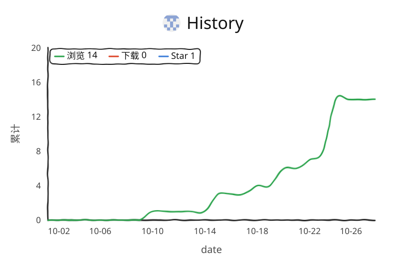

# MissAV 小助手

在 MissAV / ThisAV 的播放页上，帮你把 `m3u8` 找出来、按最高画质播放、顺手把片子下载下来。

一个用户脚本，装上就有一个小面板贴在页面上。

## 能干什么

- 自动嗅探当前页面可用的 `m3u8`
- 默认挑可用的最高分辨率，也可以手动切
- **流式下载 TS**：脚本自己抓分片、合并，最后交给浏览器下载
- **浏览器下载**：直接把最高画质的 `m3u8` 丢给浏览器
- 分片并发数可调，范围 1–16，改完自动记住
- 碰到 Cloudflare 或安全验证页，面板自动藏起来，不碍事

## 怎么装

需要先有一个用户脚本管理器：

- Chrome / Edge + Tampermonkey
- Firefox + Tampermonkey 或 Violentmonkey

然后导入 `MissAV小助手.user.js`，打开播放页即可。

## 面板怎么用

### 换分辨率

左边的分辨率按钮直接点就能切。`自动最高` 会挑当前可用的最高一档。

### 下载

- **流式下载 TS** —— 脚本内部分片拉取再合并。文件名默认只保留标题，不加 `-1080p` 这类后缀。
- **浏览器下载** —— 直接打开最高画质的 `m3u8`。如果你浏览器装了支持 HLS 的下载扩展，会被它接管。

### 并发

面板右侧可以设下载并发，1 到 16。改完自动保存到本地，下次打开还是这个数。

## 几个容易踩的点

- 脚本没法去调 Neat Download Manager 的右键菜单
- 如果 NDM 或别的扩展没有接管 `m3u8`，「浏览器下载」就只是打开或下载播放列表，不会真的变成视频文件
- 「流式下载 TS」走的是脚本自己的分片逻辑，所以 NDM 接不到它 —— 这是设计如此

## 更新记录

### 2026.6.15.10

- 下载文件名去掉 `-1080p / -720p / -bestp` 后缀

### 2026.6.15.9

- 分辨率改为可手动切换
- 并发数改为可配置并自动保存

### 2026.6.15.8

- 面板进一步精简
- 安全验证页不再显示面板

## 致谢

README 的结构和展示方式，参考了 [ChinaGodMan/UserScripts](https://github.com/ChinaGodMan/UserScripts)。
感谢这个项目在用户脚本整理和发布方式上提供的参考。

## License

MIT
